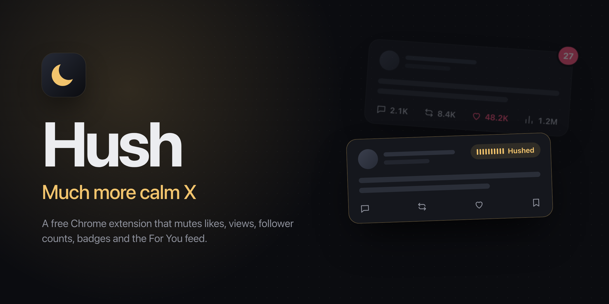
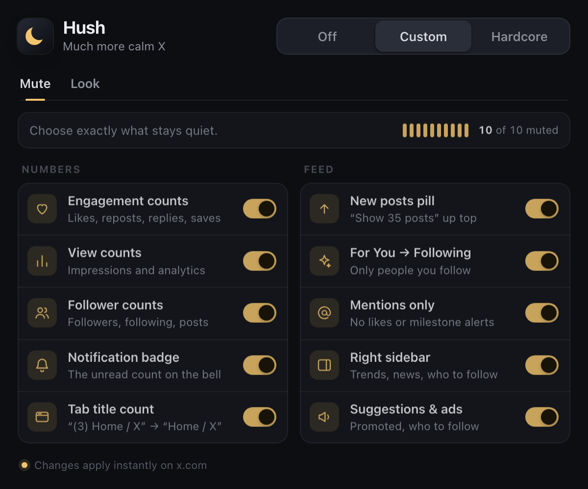
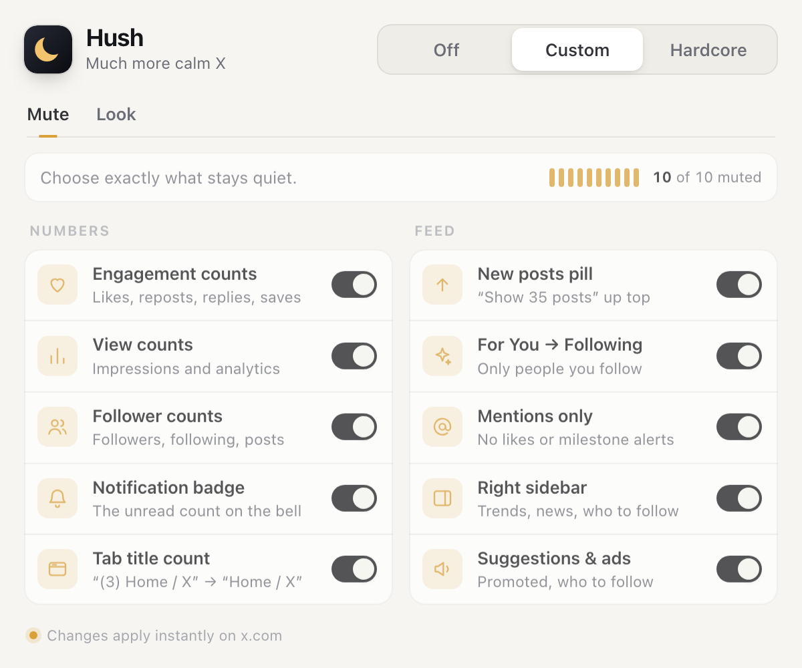

  

<h1 align="center">Hush: Much more calm X</h1>

  A free Chrome extension that takes the slot machine out of X. 
  No like counts. No view counts. No red badges. No For You. 
  Just the people you chose to follow, and what they actually said.

---

## Why I built this

I don't want to quit X. Some of the best people I follow post there, and I learn from them every day.

What I wanted to quit was everything X wraps around those posts. The like count that tells you what to think of a post before you've read it. The red badge that pulls you back in. The view counter on your own post that you check four times an hour. The "Show 35 posts" pill that never lets the feed end. The For You tab that serves whatever keeps you scrolling, not what you came for.

None of that is the content. It's packaging built to bring you back, and it works. So I made Hush to strip it out and leave the posts.

I built it for myself first. If you've ever opened X to check one thing and looked up half an hour later, it's for you too.

## What it mutes

<table>
  <tr>
    <td width="50%" valign="top">

**Numbers**

- **Engagement counts:** likes, reposts, replies, bookmarks. The buttons still work.
- **View counts:** impressions and post analytics, yours included
- **Follower counts:** followers, following and post totals on profiles and hover cards
- **Notification badge:** the unread count on the bell
- **Tab title count:** `(3) Home / X` becomes `Home / X`

</td>
    <td width="50%" valign="top">

**Feed**

- **New posts pill:** no more "Show 35 posts"
- **For You → Following:** only people you chose to follow
- **Mentions only:** notifications skip likes, milestones and "your post got 10K views"
- **Right sidebar:** trends, news and who to follow. The layout re-centers.
- **Suggestions & ads:** promoted posts, "Who to follow", "Discover more"

</td>
  </tr>
</table>

## Three modes

| Mode | What it does |
| --- | --- |
| **Off** | X as usual. |
| **Custom** | Pick exactly which of the 10 things to mute. |
| **Hardcore** | All 10 muted and locked. Leaving takes a deliberate 1.6-second hold, so you can't quit on impulse. |

## Look

A second tab for how X looks:

- **Theme:** switch between Light, Dim and Lights out in one click, instead of five menus deep in Settings
- **Grayscale:** turn images, or the whole page, black and white. Color is a big part of what makes a feed hard to put down.
- **Stop autoplay:** videos and GIFs play only when you click them

  
  

## Install

Hush isn't on the Chrome Web Store yet. To install it from this repo:

1. [Download the ZIP](../../archive/refs/heads/main.zip) and unzip it, or `git clone` this repo.
2. Open `chrome://extensions` and turn on **Developer mode** (top right).
3. Click **Load unpacked** and pick the unzipped folder.
4. Pin Hush to your toolbar and reload any open X tabs.

It works in Chrome, Brave, Arc, Edge and other Chromium browsers.

## Privacy

Hush runs only on `x.com` and `twitter.com`. It makes no network requests, has no analytics and collects nothing. Its only permission is `storage`, used to remember your switches. Everything happens in your browser by hiding parts of the page you already loaded.

## How it works

- [`src/hush.css`](src/hush.css) hides what plain selectors can reach. Every rule is gated on a `hush-<feature>` class on `<html>`, so switches apply instantly in both directions.
- [`src/content.js`](src/content.js) sets those classes from your settings and tags the trickier elements (found by text or position) with `data-hush="<feature>"`.
- Selectors cover both X's current markup (`data-engagement-action`, `<use href="#icon-…">`) and the older `data-testid` markup.

X changes its markup often. If a number creeps back, please [open an issue](../../issues) with a screenshot, and if you can, the HTML of the element (right-click → Inspect).

## Development

- `python3 scripts/make_icons.py` regenerates the toolbar icons (needs Pillow).
- `scripts/render_docs.sh` re-renders `docs/og.png` and the popup screenshots with a headless Chromium. It defaults to Brave; pass another browser binary as the first argument.

## License

[MIT](LICENSE)
